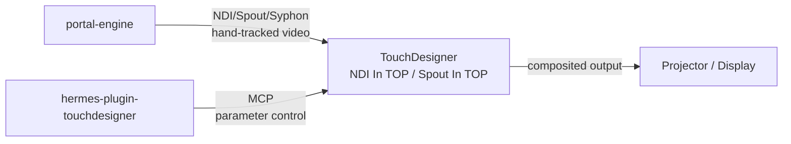

# Portal Engine

Cross-platform interactive portal engine for Hermes — OpenCV + MediaPipe hand tracking with real-time visual effects. Outputs via **Syphon (macOS)**, **Spout (Windows)**, **NDI (cross-platform)**, or **virtual camera (Linux)** for MadMapper/Resolume/TouchDesigner integration.

## Features

- 🎯 **Real-time hand tracking** via MediaPipe (up to 4 hands)
- ✨ **Visual effects**: glowing hands, portal rings, pass-through portals, particle trails
- 🎮 **Full agent control** via 8 Hermes tools
- 📐 **Camera calibration** (auto, manual click, checkerboard)
- 🖥️ **Projector support** for projection mapping installations
- 📡 **Professional video output** — Syphon/Spout/NDI/virtual camera for MadMapper, Resolume, TouchDesigner, vMix, OBS
- 🔌 **Clean integration** — backend plugin with hooks for auto-cleanup

## Installation

```bash
# From local directory
hermes plugins install ~/.hermes/plugins/portal_engine --enable

# Or from git (when published)
hermes plugins install github:yourname/portal-engine --enable
```

## Quick Start

```bash
# List cameras
hermes portal_engine list_cameras

# Start portal engine
hermes portal_engine start

# Calibrate for your screen/projector
hermes portal_engine calibrate --method auto --width 1920 --height 1080

# Start output bridge (auto-detects best protocol: Syphon/macOS, Spout/Windows, NDI/Linux)
hermes portal_engine syphon_start --server_name PortalEngine

# Check status
hermes portal_engine status

# Stop
hermes portal_engine syphon_stop
hermes portal_engine stop
```

## Tools

| Tool | Description |
|------|-------------|
| `portal_start` | Start hand tracking with visual effects |
| `portal_stop` | Stop the portal engine |
| `portal_calibrate` | Calibrate camera to screen/projector |
| `portal_status` | Get current status and hand positions |
| `portal_list_cameras` | List available cameras |
| `portal_syphon_start` | Start Syphon/Spout/NDI/virtual camera output bridge |
| `portal_syphon_stop` | Stop output bridge |
| `portal_syphon_status` | Get output bridge status + available protocols |

## Configuration

Add to your profile's `config.yaml`:

```yaml
portal_engine:
  default_camera_index: 0
  effect_intensity: 1.0
  portal_width: 1920
  portal_height: 1080
  show_fps: true
  enable_projector_mode: false
```

## Output Protocols (Auto-Detected)

| Platform | Preferred | Fallback | Use With |
|----------|-----------|----------|----------|
| **macOS** | Syphon | NDI | MadMapper, VDMX, Modul8, Resolume |
| **Windows** | Spout | NDI | Resolume, MadMapper, TouchDesigner, vMix |
| **Linux** | NDI | Virtual Camera | OBS, Zoom, browser apps, MadMapper |

**Installation:**
```bash
# NDI (cross-platform, professional)
pip install ndi-python          # + install NDI 5 SDK from ndi.video

# Spout (Windows native, GPU texture sharing)
pip install spout-gl

# Virtual Camera (Linux)
pip install pyvirtualcam        # + sudo modprobe v4l2loopback

# All platforms: Shared Memory (fallback, always works)
# No extra install needed
```

## Works with Official TouchDesigner Plugin

The [`hermes-plugin-touchdesigner`](https://github.com/NousResearch/hermes-plugin-touchdesigner) provides **MCP-based control** of TouchDesigner (set parameters, trigger operators, run scripts). Combined with `portal-engine`'s **NDI/Spout/Syphon video output**, you get a complete bidirectional pipeline:



**Example combined workflow:**

```python
# 1. Start portal-engine (tracks hands, outputs video via NDI)
portal_start({"effect_mode": "all"})
portal_syphon_start({"protocol": "ndi", "server_name": "PortalEngine"})

# 2. In TouchDesigner: Add "NDI In TOP" → select "PortalEngine" → composite onto geometry

# 3. Hermes controls TouchDesigner based on hand data
status = portal_status()  # Get hand positions
hand_x = status["current_frame"]["hands"][0]["center"][0]
normalized_x = hand_x / 1920  # 0.0 to 1.0

# 4. Control TouchDesigner via MCP (using touchdesigner plugin)
# touchdesigner_set_param("/project1/portal_geo", "tx", normalized_x * 2 - 1)
# touchdesigner_run_script("update_portal_shader", {"intensity": 0.8})
```

**Why both?**
| Plugin | Direction | Role |
|--------|-----------|------|
| `portal-engine` | Hermes → NDI/Spout/Syphon → TouchDesigner | **Video input** (perception) |
| `hermes-plugin-touchdesigner` | Hermes → MCP → TouchDesigner | **Parameter control** (action) |

Together they enable interactive installations where hand tracking drives both visuals AND logic in TouchDesigner.

## Calibration Profiles

Saved to `~/.config/portal_engine/<profile>.json`

```bash
# List profiles
hermes portal_engine status | jq .profiles

# Load a profile (done automatically on start if "default" exists)
```

## Dependencies

```bash
# Core (required)
pip install mediapipe opencv-python numpy

# Python version: 3.8–3.12 ONLY (MediaPipe has no wheels for 3.13+)
```

**System requirements:**
- Python **3.8–3.12** (3.13+ not supported — MediaPipe wheels unavailable)
- Camera (built-in or USB)
- OpenCV with GUI support
- Optional: Projector for projection mapping

## Hardware Disclosure

- **Camera access**: Required for hand tracking (OpenCV VideoCapture)
- **Display window**: Opens OpenCV window for real-time visualization
- **Projector (optional)**: For projection mapping on secondary display
- **No network access**: All processing is local (NDI/Spout/Syphon use local IPC)
- **No shell commands**: Pure Python/OpenCV

## Architecture

```
portal_engine/
├── plugin.yaml              # Plugin manifest (python_runtime: >=3.8,<3.13)
├── __init__.py              # Entry point + hooks + Python version check
├── schemas.py               # Tool JSON schemas
├── tools.py                 # 8 tool handlers
├── portal_tracker.py        # MediaPipe hand tracker
├── portal_effects.py        # Visual effects renderer
├── portal_calibration.py    # Calibration utilities
├── portal_output.py         # Syphon/Spout/NDI/virtual camera output
├── skills/
│   └── portal_engine/       # Bundled skill
│       └── SKILL.md
├── README.md
├── HOWTO.md                 # Step-by-step guide
├── WINDOWS_HOWTO.md         # Windows-specific setup
└── HACKATHON.md             # This file
```

## Hackathon Entry

Built for the **NousResearch Hermes Agent Plugin Hackathon**.

- **Usefulness**: Full agent control of interactive CV system + professional video output
- **Reliability**: Graceful degradation, session-end cleanup hook, clear error messages
- **Polish**: Multiple effect modes, calibration methods, config schema, cross-platform output
- **Creativity**: Viral portal concept adapted for software-first agent control + MadMapper/Resolume integration

## License

MIT